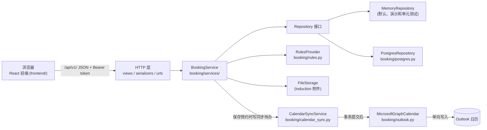
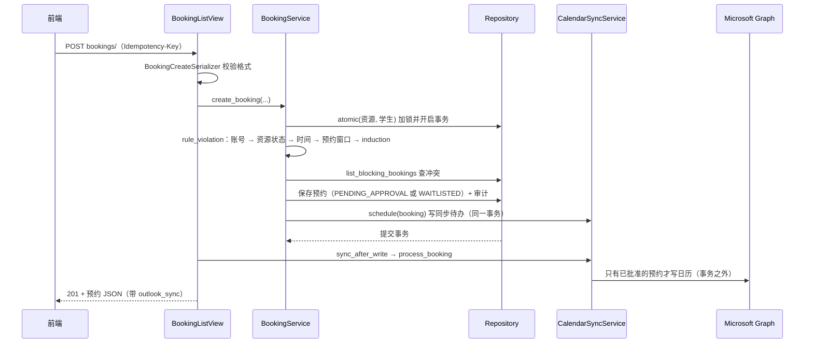

# 架构说明

这份文档说明 SmartLab 各部分怎么分工、一次请求怎么走、改代码时去哪里改。具体规则看各目录的 README 和 `backend/docs/`；历次改动看 [CHANGELOG.md](CHANGELOG.md)。

## 1. 总览



- **网站是唯一依据。** 所有规则都在后端的 `BookingService` 里执行；前端隐藏按钮只是体验，不是权限。
- **Outlook 只写不读。** 系统从不读取 Outlook 里的修改，所以 Outlook 里做什么都不会变成预约。
- **存储可替换。** 业务代码只依赖 `Repository`、`FileStorage`、`RulesProvider`、`CalendarProvider` 这几个接口，用环境变量选实现（见第 6 节）。

## 2. 目录

```text
team-repo/
├── ARCHITECTURE.md, CHANGELOG.md, README.md
├── backend/                     Django 5.2 + DRF
│   ├── config/                  settings.py（全部配置都读环境变量）、urls.py
│   ├── booking/
│   │   ├── views.py             HTTP 接口：解析请求 → 调用 service → 转 JSON
│   │   ├── serializers.py       请求参数校验
│   │   ├── urls.py              /api/v1/ 下的路径
│   │   ├── services/            业务规则（见第 3 节）
│   │   ├── domain.py            实体（dataclass）和状态枚举
│   │   ├── errors.py            DomainError(code, message, status)
│   │   ├── exceptions.py        把错误统一成 {"error": {code, message, details}}
│   │   ├── repository.py        Repository 接口 + 内存实现
│   │   ├── postgres.py          PostgreSQL 实现（含附件存储）
│   │   ├── rules.py             可配置的全局数字（提前天数、有效期…）
│   │   ├── storage.py           FileStorage 接口 + 内存实现
│   │   ├── authentication.py    演示登录和 token；以后接学校 SSO 的位置
│   │   ├── calendar_sync.py     Outlook 同步待办（outbox）：重试、租约、重建
│   │   ├── outlook.py           Microsoft Graph 适配器和登录辅助
│   │   ├── runtime.py           组装各部分（composition root）+ 演示种子数据
│   │   ├── management/commands/ process_due、process_outlook、outlook_token、outlook_login、outlook_live_check
│   │   └── tests/               全部后端测试
│   ├── database/                schema.sql、种子数据、migrations/
│   └── docs/                    openapi.json、frontend-api.md、database-interface.md、outlook-setup.md
└── frontend/                    React + TypeScript + Vite
    ├── src/app/                 路由、权限表 routes.ts、页面框架 AppLayout
    ├── src/features/            按功能分：auth、dashboard、booking、induction、admin、manager
    ├── src/lib/api-client.ts    请求、token、401 处理
    ├── src/ui/                  通用组件和提示
    └── tests/                   node --test 单元测试 + Playwright（接口全部 mock）
```

## 3. 后端分层

| 层 | 位置 | 只做什么 |
| --- | --- | --- |
| HTTP | `views.py`、`serializers.py`、`urls.py` | 校验参数格式、找到当前用户、调用 service、把结果转成 JSON、事务结束后触发 Outlook 同步 |
| 业务规则 | `booking/services/` | 权限、资格、时间、冲突、审批、候补、审计。不知道 HTTP，也不知道用的是哪种数据库 |
| 实体 | `domain.py` | 数据结构和简单的字段校验 |
| 存储 | `repository.py`、`postgres.py`、`storage.py` | 读写和事务锁，不做业务判断 |
| 外部服务 | `calendar_sync.py`、`outlook.py` | Outlook 同步，失败不影响预约本身 |

`BookingService` 是唯一的业务入口，由几个按主题分的 mixin 组成，方法都挂在同一个对象上：

| 文件 | 内容 |
| --- | --- |
| `base.py` | 时钟、规则读取、角色检查、审计写入、资源查找、状态分组常量 |
| `accounts.py` | 用户列表与停用、员工账号（邀请码、登录）、查找代订对象 |
| `resources.py` | Manager 的资源设置（审批期限、维护/关闭）和预约报表 |
| `qualifications.py` | induction 上传、审核、有效期、前置资格 |
| `checks.py` | 所有路径共用的规则检查 `rule_violation` 和冲突查询 |
| `bookings.py` | 创建（含代订、紧急）、审批、取消、Manager 改期 |
| `waitlist.py` | 过期处理、超时自动决定、候补递补 |
| `availability.py` | 单个资源某天的时段，以及预约页的全天总览 |
| `audit.py` | 审计记录查询 |

## 4. 一次预约请求怎么走

以学生提交预约 `POST /api/v1/bookings/` 为例：



要点：

1. **同一套规则检查。** 创建、人工批准、超时自动处理、候补递补、改期都调用 `checks.py` 的 `rule_violation`，所以任何路径都绕不过资格或冲突检查。
2. **先加锁再检查。** 查冲突和写入都在 `atomic(resource_ids, student_ids)` 里完成，两个人同时抢同一时段只会有一人占位。
3. **网络调用在事务外。** Graph 调用失败只会让同步状态变成 `FAILED` 并自动重试，预约本身已经保存。
4. **区间是 `[start, end)`。** API 输出 UTC，开放时间等规则按 `Australia/Sydney` 解释。

## 5. 时间推进

审批期限到了自动批准或拒绝、开始时间过了改为 `EXPIRED`、空出来的时段递补给候补，这些都在 `waitlist.py` 的 `process_due_requests` 里完成。它在三个地方被调用：

- 读取预约、时段、dashboard 的接口会先调用一次（所以前端只需要刷新）。
- `POST admin/process-due/`。
- 定时命令 `manage.py process_due`（数据库模式，例如每分钟一次）。它也会处理等待中的 Outlook 同步。

## 6. 可替换的部分

| 环境变量 | 默认 | 换成什么 |
| --- | --- | --- |
| `REPOSITORY_FACTORY` | 内存 | `booking.postgres.PostgresRepository` |
| `FILE_STORAGE_FACTORY` | 内存 | `booking.postgres.PostgresFileStorage` |
| `RULES_PROVIDER` | `booking.rules.SettingsRulesProvider`（读环境变量） | 以后可以换成读数据库、让 Manager 在页面上改 |
| `AUTH_PROVIDER` | `booking.authentication.DemoIdentityProvider` | 以后换成学校 SSO |
| `OUTLOOK_PROVIDER_FACTORY` | `booking.outlook.make_graph_calendar` | 测试里换成假的日历 |

组装都在 `runtime.py` 的 `get_service()` 里。非 DEBUG 模式下不允许使用内存存储。

## 7. 前端

- `src/app/AppRouter.tsx` 定义页面路由；`src/app/routes.ts` 是权限表（哪个角色能进哪个页面）；`AppLayout.tsx` 是菜单和页面框架。
- 每个功能在 `src/features/<功能>/` 里，页面组件、接口调用和样式放在一起。业务接口集中在 `features/booking/api.ts`，类型在 `features/booking/types.ts`。
- `src/lib/api-client.ts` 统一处理 token、JSON、文件上传下载和登录失效。
- 显示时间一律按 `Australia/Sydney`（`features/booking/format.ts`）。
- 测试：`tests/*.test.mjs` 用 `node --test` 直接导入 `.ts` 文件（导入路径要写 `.ts` 扩展名）；`tests/routing.spec.ts` 是 Playwright，接口全部 mock，不需要后端。

## 8. 数据库

- `backend/database/schema.sql` 是新建库的标准结构，`seed_*.sql` 是演示数据。
- 改表结构时：同时改 `schema.sql`、`postgres.py` 的字段映射，并在 `migrations/` 加一个**可重复执行**的脚本（`ADD COLUMN IF NOT EXISTS`、先 `DROP CONSTRAINT IF EXISTS` 再加约束、数据更新带条件）。
- 验证方法：新建一个库，再拿一个按旧脚本建的库执行全部升级脚本（执行两遍），比较两边的 `pg_dump --schema-only`，必须完全一致。
- 并发安全靠 `atomic` 里的数据库锁（PostgreSQL 用 advisory lock），不是靠前端。

## 9. 加一个功能的步骤

1. **实体**：`domain.py` 加字段。
2. **数据库**：`schema.sql` + `postgres.py` + 新迁移脚本 + 种子数据（如需要）。
3. **规则**：在 `booking/services/` 对应主题的文件里加方法；新主题就新建一个 mixin 文件，加进 `services/__init__.py` 的继承列表。会影响能不能预约的规则，加进 `checks.py` 的 `rule_violation`，保证所有路径都检查到。
4. **接口**：`serializers.py` → `views.py` → `urls.py`。
5. **接口文档**：`docs/openapi.json`（改版本号）+ `docs/frontend-api.md`。
6. **前端**：`types.ts` → `api.ts` → 页面；新页面还要改 `routes.ts`、`AppRouter.tsx`、`AppLayout.tsx`。
7. **测试**：后端单元测试、PostgreSQL 集成测试（`test_postgres.py`）、前端单元测试、Playwright。
8. **CHANGELOG.md** 记一条。

## 10. 文档地图

| 想知道 | 看 |
| --- | --- |
| 怎么启动、演示账号、功能和规则 | [backend/README.md](backend/README.md)、[frontend/README.md](frontend/README.md) |
| 前端怎么调接口、错误码 | [backend/docs/frontend-api.md](backend/docs/frontend-api.md)、[openapi.json](backend/docs/openapi.json) |
| 本地 PostgreSQL、升级数据库 | [backend/database/README.md](backend/database/README.md) |
| 数据库适配器要遵守的约定 | [backend/docs/database-interface.md](backend/docs/database-interface.md) |
| Outlook 配置和实测 | [backend/docs/outlook-setup.md](backend/docs/outlook-setup.md) |
| 以前改过什么、为什么 | [CHANGELOG.md](CHANGELOG.md) |
