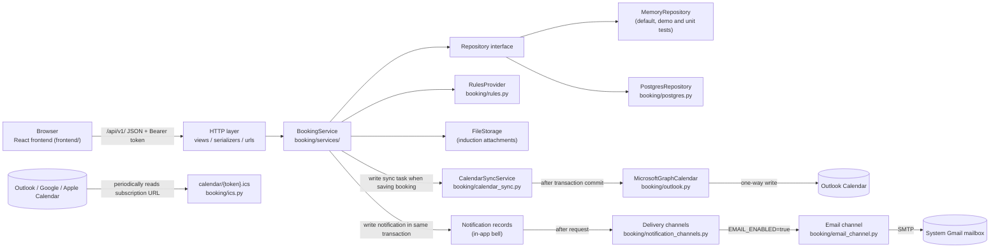
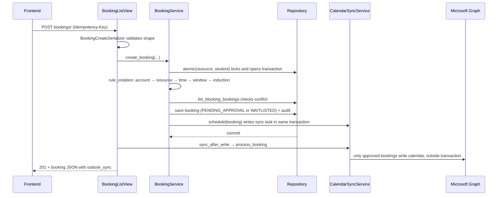

# Architecture

This document explains how SmartLab components divide responsibilities, how a request travels through the system and where to make code changes. See each directory's README and `backend/docs/` for exact rules, and [CHANGELOG.md](CHANGELOG.md) for change history.

## 1. Overview



- **The website is authoritative.** Every rule runs in backend `BookingService`; hiding a frontend button improves the experience but is not access control.
- **Outlook is write-only.** The system never reads Outlook changes, so an Outlook action cannot become a booking. A calendar subscription is also read-only: calendar software reads but cannot modify it.
- **Storage is replaceable.** Business code depends only on `Repository`, `FileStorage`, `RulesProvider` and `CalendarProvider`, selected through environment variables; see Section 6.

## 2. Directory layout

```text
team-repo/
├── ARCHITECTURE.md, CHANGELOG.md, README.md, SPRINT3.md
├── backend/                     Django 5.2 + DRF
│   ├── config/                  settings.py (all configuration from environment), urls.py
│   ├── booking/
│   │   ├── views/               HTTP endpoints: parse request → call service → return JSON
│   │   │                        (split 25 Oct 2026 into auth, resources, bookings, admin, outlook,
│   │   │                         notifications, calendar, series, misc; shared imports/helpers in _common.py)
│   │   ├── serializers.py       Request validation
│   │   ├── urls.py              Paths under /api/v1/
│   │   ├── services/            Business rules (Section 3)
│   │   ├── domain.py            Entities (dataclasses) and state enums
│   │   ├── errors.py            DomainError(code, message, status)
│   │   ├── exceptions.py        Normalises errors to {"error": {code, message, details}}
│   │   ├── repository.py        Repository interface: every read and write the rules need
│   │   ├── memory.py            In-memory implementation (tests and local demo)
│   │   ├── postgres.py          PostgreSQL implementation, including attachment storage
│   │   ├── rules.py             Configurable global values: notice, validity, etc.
│   │   ├── storage.py           FileStorage interface + memory implementation
│   │   ├── authentication.py    Demo sign-in/tokens; future university SSO integration point
│   │   ├── calendar_sync.py     Outlook sync outbox: retry, lease and recreation
│   │   ├── outlook.py           Microsoft Graph adapter and sign-in helpers
│   │   ├── ics.py               Calendar subscription content (iCalendar)
│   │   ├── notification_channels.py  Additional notification-channel interface
│   │   ├── email_channel.py     Email channel to beneficiary university addresses (Sprint 3)
│   │   ├── middleware.py        CORS; invokes notification channels after each request
│   │   ├── runtime.py           Composition root + demo seed data
│   │   ├── management/commands/ run_scheduler, process_due, create_manager, send_test_email,
│   │   │                         outlook_token, outlook_login, outlook_live_check
│   │   └── tests/               All backend tests
│   ├── database/                schema.sql, seed data, migrations/
│   └── docs/                    openapi.json, frontend-api.md, database-interface.md,
│                            outlook-setup.md, email-setup.md
└── frontend/                    React + TypeScript + Vite
    ├── src/app/                 Routes, permission table routes.ts, AppLayout shell
    ├── src/features/            auth, dashboard, booking, induction, admin, manager,
    │                        notifications, records and contact features
    ├── src/lib/api-client.ts    Requests, token and 401 handling
    ├── src/ui/                  Shared components and feedback
    └── tests/                   node --test units + Playwright with fully mocked APIs
```

## 3. Backend layers

| Layer | Location | Sole responsibility |
| --- | --- | --- |
| HTTP | `views/`, `serializers.py`, `urls.py` | Validate request shape, resolve current user, call service, convert to JSON and trigger Outlook sync after the transaction |
| Business rules | `booking/services/` | Permission, qualification, time, conflict, review, waitlist and audit; independent of HTTP and database choice |
| Entities | `domain.py` | Data structures and simple field validation |
| Storage | `repository.py` (interface), `postgres.py`, `memory.py`, `storage.py` | Persistence and transactional locking without business decisions |
| External services | `calendar_sync.py`, `outlook.py` | Outlook synchronisation whose failure does not affect the booking |

`BookingService` is the sole business entry point, assembled from topic mixins whose methods share one object:

| File | Responsibility |
| --- | --- |
| `base.py` | Clock, rules, roles, audit writing, resource lookup and status-group constants |
| `accounts.py` | User listing/deactivation, staff invites/sign-in and beneficiary lookup |
| `resources.py` | Manager resource create/edit/archive/restore, `_check_resource_fields`, review windows, status and records |
| `qualifications.py` | Induction upload, review, validity and prerequisites |
| `checks.py` | Shared `rule_violation` and conflict queries |
| `bookings.py` | Creation including on-behalf/urgent, review, cancellation and Manager reschedule |
| `waitlist.py` | Expiry, automatic deadline decisions and promotion |
| `availability.py` | One resource's daily slots and the all-resource day overview |
| `audit.py` | Audit queries |
| `notifications.py` | `_booking_changed` recipients and notification read state |
| `calendar_feed.py` | Subscription token generation/reset and feed contents |
| `attendance.py` | Check-in and absence; freeze removed in 1.25.0 |
| `series.py` | Staff recurring bookings, per-date checks, immediate approval and series cancellation |
| `reminders.py` | One-time next-day booking and induction-expiry reminders |
| `reports.py` | Read-only Manager usage report |
| `changes.py` | Beneficiary replacement request and original cancellation on approval (1.16.0) |
| `site_contact.py` | Manager-updated, publicly readable laboratory contact (1.16.0) |
| `overview.py` | Read-only staff Today totals and lists (1.16.0) |

## 4. Booking request flow

For student `POST /api/v1/bookings/`:



Key points:

1. **One rule check.** Creation, manual approval, automatic deadline processing, waitlist promotion and rescheduling all call `checks.py` `rule_violation`; no path skips qualification or conflict.
2. **Lock before checking.** Conflict reads and writes occur inside `atomic(resource_ids, student_ids)`, so only one simultaneous applicant holds the time.
3. **Network outside the transaction.** A Graph failure changes sync to `FAILED` for retry but the booking is already saved.
4. **Notifications follow state.** `_save_booking` compares old/new state and selects approval, rejection, promotion, reschedule or staff cancellation notifications. Notification and booking save in one transaction. Middleware invokes external channels afterward; failure cannot affect the booking.
5. **Intervals are `[start, end)`.** The API emits UTC while opening rules use `Australia/Sydney`.

## 5. Time advancement

`process_due_requests` in `waitlist.py` automatically approves/rejects at review deadlines, expires requests after start and promotes the waitlist when time opens. It then processes attendance in `attendance.py`, recording an unconfirmed approved booking after the check-in window as an absence without penalty, and sends due reminders in `reminders.py`. It runs from:

- Booking, availability and dashboard reads, so a frontend refresh is sufficient.
- `POST admin/process-due/`.
- Scheduled `manage.py process_due` in database mode, for example every minute, which also processes pending Outlook sync.

## 6. Replaceable components

| Environment variable | Default | Replacement |
| --- | --- | --- |
| `REPOSITORY_FACTORY` | Memory | `booking.postgres.PostgresRepository` |
| `FILE_STORAGE_FACTORY` | Memory | `booking.postgres.PostgresFileStorage` |
| `RULES_PROVIDER` | `booking.rules.SettingsRulesProvider`, environment-backed | Future database-backed Manager editing |
| `AUTH_PROVIDER` | `booking.authentication.DemoIdentityProvider` | University SSO |
| `OUTLOOK_PROVIDER_FACTORY` | `booking.outlook.make_graph_calendar` | Fake calendar in tests |
| `NOTIFICATION_CHANNELS` | Empty, in-app only; `EMAIL_ENABLED=true` adds `booking.email_channel.EmailChannel` | Other channels such as Outlook mail |

`get_service()` in `runtime.py` composes them. Non-DEBUG mode forbids memory storage.

## 7. Frontend

- `src/app/AppRouter.tsx` defines routes; `src/app/routes.ts` maps roles to pages; `AppLayout.tsx` supplies navigation and shell.
- Each `src/features/<feature>/` keeps page, calls and styles together. The bell is in `features/notifications/`. Domain-split APIs are under `src/api/` and re-exported by `index.ts`; types are in `src/api/types/`.
- `src/lib/api-client.ts` handles token, JSON, uploads/downloads and expired sessions.
- Times display in `Australia/Sydney` through `features/booking/format.ts`.
- `tests/*.test.mjs` uses `node --test` and imports `.ts` with the extension. `tests/routing.spec.ts` is Playwright with fully mocked APIs and needs no backend.

## 8. Database

- `backend/database/schema.sql` defines a new database; `seed_*.sql` provides demo data.
- A schema change updates `schema.sql`, `postgres.py` mappings and adds a **repeatable** migration using patterns such as `ADD COLUMN IF NOT EXISTS`, `DROP CONSTRAINT IF EXISTS` before adding, and conditional data updates.
- Verify by comparing `pg_dump --schema-only` from a new database with an old-script database after running all migrations twice; they must match exactly.
- Concurrency safety comes from database locks inside `atomic`, PostgreSQL advisory locks in this adapter, not the frontend.

## 9. Adding a feature

1. **Entity:** add fields to `domain.py`.
2. **Database:** update `schema.sql`, `postgres.py`, a new migration and seeds if needed.
3. **Rules:** add methods to the matching `booking/services/` topic; add a new mixin to `services/__init__.py` for a new topic. Booking eligibility belongs in `checks.py` `rule_violation` so every path checks it.
4. **Endpoint:** `serializers.py` → `views/` → `urls.py`.
5. **API documentation:** update `docs/openapi.json` and its version, plus `docs/frontend-api.md`.
6. **Frontend:** `types.ts` → `api.ts` → page; a new page also updates `routes.ts`, `AppRouter.tsx`, `AppLayout.tsx`.
7. **Tests:** backend unit, PostgreSQL integration, frontend unit and Playwright.
8. Add a **CHANGELOG.md** entry.

## 10. Rule locations for Sprint 3 features

Use this table to find the implementation of a rule. Function headers explain what and why. Sprint 3 code is marked in files and listed completely in [SPRINT3.md](SPRINT3.md).

| Rule | Function |
| --- | --- |
| Personal-history removal eligibility and beneficiary/creator scope (1.20.0) | `services/bookings.py` `remove_booking_history`; both repositories' `hide_booking`, `hidden_booking_ids`; `views/bookings.py` `my_bookings` for personal lists/Dashboard; reports ignore hiding |
| My Bookings resource/category intersection and per-date actions (1.20.0) | `MyBookings.tsx`; `my-bookings.ts` `canRemoveBookingHistory`; `SeriesCard.tsx` |
| Resource field rules: unique name, room/equipment, step, maximum duration | `services/resources.py` `_check_resource_fields` |
| Future bookings outside edited rules | `services/resources.py` `_bookings_outside_rules` |
| Archive restrictions | `services/resources.py` `archive_resource` |
| Check-in window, 15 minutes before to 30 after | `services/attendance.py` `check_in_window` |
| Absence definition, recorded without freeze since 1.25.0 | `services/attendance.py` `_process_attendance` |
| Manager booking overrides and retained checks (1.24.0) | `services/bookings.py` `_create_manager_booking`, `reschedule_booking`; `services/availability.py` `_availability` (`override`) |
| Extension eligibility, timing and checks; Manager approval for student extension (1.27.0) | `services/changes.py` `extend_booking`, `review_extension`, `_check_extension`; frontend `features/booking/extend.ts`, `ExtendBox.tsx` |
| Three-booking weekly limit | `services/checks.py` `_weekly_limit_violation` |
| Per-date recurring checks | `services/series.py` `_series_check` |
| Booking-change recipients | `services/notifications.py` `_booking_changed` |
| Reminder timing | `services/reminders.py` `_booking_reminders`, `_induction_reminders` |
| Usage-report calculations | `services/reports.py` `usage_report` |
| Records name/zID search and Admin seven-day history (1.26.0) | `services/resources.py` `booking_report` (`query`, `ADMIN_HISTORY_DAYS`) |
| Equipment internal-information access, Manager-only (1.26.0) | `services/resources.py` `resource_internal_info`, `update_resource_internal_info`; separate `resource_internal_info` table, absent from resource JSON |
| Request-received confirmation | `services/bookings.py` `_created_notices`; recurring in `services/series.py` `create_series` |
| Email kinds, recipients, subjects and bodies | `email_channel.py` `EmailChannel.deliver`, `choose_recipient`, `compose`; `settings.py` `EMAIL_NOTIFICATION_KINDS` |
| Grouping recurring bookings in My Bookings | `features/booking/my-bookings.ts` `groupBookings`, `seriesSummary` |
| Display durations in hours | `features/booking/format.ts` `fmtDuration` |
| Bell animation, notification grouping and icons | `features/notifications/notifications.ts` `shouldRing`, `groupNotifications`, `notificationIcon` |
| Resource cover selection | `features/booking/covers.ts` `coverKey` |
| Current-time line position and visibility | `features/booking/slot-cells.ts` `nowLineFraction` |
| Motion timing, easing and reduced motion | `src/index.css` `--motion-*`, `--ease-*`, `prefers-reduced-motion` |
| Calendar feed contents | `services/calendar_feed.py` `calendar_feed_events`; format in `ics.py` |
| Staff password rules | `services/accounts.py` `change_password` |
| Who can request a time change and when (1.16.0) | `services/changes.py` `request_time_change` |
| Cancel original on change approval (1.16.0) | `services/changes.py` `_apply_time_change`, invoked by `base.py` `_save_booking` |
| Exclude original from change conflict, duplicate and weekly allowance (1.16.0) | `services/bookings.py` `create_booking` (`replaces`); `services/checks.py` `_overlaps` (`also_exclude`) |
| Status-change recipients (1.16.0) | `services/resources.py` `_notify_status_change`, called by `set_resource_status` |
| Room capacity and label/value limits (1.16.0) | `services/resources.py` `_check_resource_fields`, `MAX_DETAILS` |
| A resource may need no induction; equipment never inherits its room's (1.30.0) | `services/qualifications.py` `qualification_state` (`NOT_REQUIRED`); `services/resources.py` `create_resource`, `_check_resource_fields`; frontend `ManagerResourcesPage.tsx` induction select |
| Induction create/edit and guidance (1.16.0) | `services/qualifications.py` `create_requirement`, `update_requirement`, `_check_requirement_fields` |
| Contact edit permissions and fields (1.16.0) | `services/site_contact.py` `update_site_contact`, `CONTACT_FIELDS` |
| Today calculations (1.16.0) | `services/overview.py` `staff_overview` |
| Find a free time hidden resources/reasons (1.16.0) | `services/availability.py` `day_overview` (`too_long`, `not_bookable`); frontend `features/booking/find-time.ts` `hiddenSummary` |
| Disabled booking submit explanation (1.16.0) | Frontend `features/booking/format.ts` `submitBlocker` |
| Test account available only with development switch and memory store; role not persisted (1.17.0) | `booking/test_console.py` `test_console_enabled`, `test_identity`; `authentication.py` `issue_demo_token`, `DemoIdentityProvider.resolve_bearer` |
| Own test bookings bypass business rules but keep time, duplicate and conflict checks (1.17.0) | `test_console.py` `booking_rules_bypassed`, `test_period_violation`, `create_test_booking`; `services/bookings.py` `create_booking`, `reschedule_booking` |
| Own test-booking availability and recurring use same exception (1.17.0) | `test_console.py` `test_availability`, `test_window`; `services/series.py` `_series_check`, `_series_plan` |
| Account 1 receives every permanent induction, including new requirements, without evidence (1.17.1) | `test_console.py` `get_test_account`, `_grant_test_inductions`; `authentication.py` `DemoIdentityProvider.resolve_bearer`; `views/_common.py` `submission_json`; frontend `induction/InductionPage.tsx` |
| Test data sends no external messages or calendar sync (1.17.0) | `services/base.py` `_save_booking`; `views/_common.py` `sync_after_write`; `notification_channels.py` `deliver_new_notifications` |
| One urgent explanation and required evidence prompt (1.17.0) | Frontend `BookingForm.tsx` `bookingPurpose`; `induction/evidence.ts` `evidenceProblem` |
| Role home: Admin Today, Manager Lab overview since 1.26.0; Today cards | Frontend `app/routes.ts` `homePath`; `features/admin/today.ts` `cardsFor` |
| Independent notification channels and email-only records excluded from bell (1.19.0) | `services/notifications.py` `_category_channels`, `_notify`, `list_notifications`, `mark_notification_read`, `mark_all_notifications_read`; `notification_channels.py` `deliver_new_notifications` |
| Five-category partial saves, defaults and site email capability (1.19.0) | `services/notifications.py` `notification_preferences`, `save_notification_preferences`; `views/notifications.py` `NotificationPreferencesView` |
| Announcement activity, expiry, author editing and Manager removal (1.19.0) | `services/announcements.py` `list_announcements`, `create_announcement`, `update_announcement`, `remove_announcement`; `views/announcements.py` performs write permission precheck |
| Maintenance/closure automatic announcement, same-resource update and removal on available (1.19.0) | `services/resources.py` `set_resource_status` calls `AnnouncementsMixin._status_announcement` inside resource transaction; unique index `announcement_resource_status_idx` |
| Announcement attribution and recovery estimate independent of expiry (1.19.0) | `domain.py` `Announcement.author_role/expected_back`; `views/announcements.py` `announcement_json`; frontend `AnnouncementBoard.tsx` `AnnouncementText` |
| Notification/announcement mobile layout and Sydney date input (1.19.0) | `NotificationPreferences.tsx`, `AnnouncementsPage.tsx`, `dates.ts`, `ResourceStatusDialog.tsx`; new styles only in `ui/workspace.css` |
| Default values for every number | `rules.py` `BookingRules`; environment variables in `.env.example` |

## 11. Documentation map

| Question | Document |
| --- | --- |
| Startup, demo accounts, features and rules | [backend/README.md](backend/README.md), [frontend/README.md](frontend/README.md) |
| Frontend API use and errors | [backend/docs/frontend-api.md](backend/docs/frontend-api.md), [openapi.json](backend/docs/openapi.json) |
| Local PostgreSQL and upgrades | [backend/database/README.md](backend/database/README.md) |
| Database adapter contract | [backend/docs/database-interface.md](backend/docs/database-interface.md) |
| Outlook setup and live test | [backend/docs/outlook-setup.md](backend/docs/outlook-setup.md) |
| Email setup and testing | [backend/docs/email-setup.md](backend/docs/email-setup.md) |
| Previous changes and reasons | [CHANGELOG.md](CHANGELOG.md) |
| Sprint 3 features and code | [SPRINT3.md](SPRINT3.md) |
