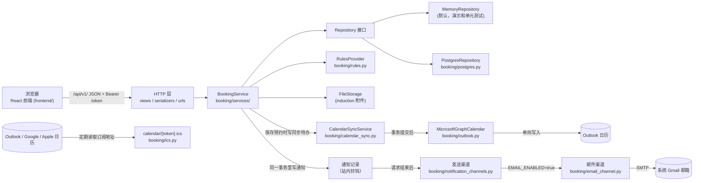
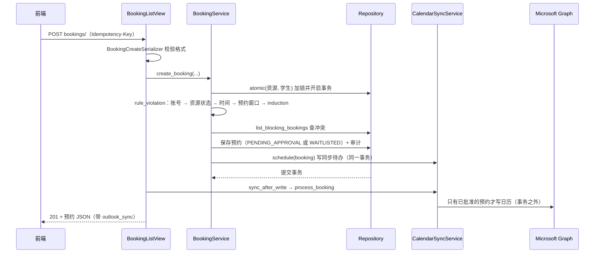

# 架构说明

这份文档说明 SmartLab 各部分怎么分工、一次请求怎么走、改代码时去哪里改。具体规则看各目录的 README 和 `backend/docs/`；历次改动看 [CHANGELOG.md](CHANGELOG.md)。

## 1. 总览



- **网站是唯一依据。** 所有规则都在后端的 `BookingService` 里执行；前端隐藏按钮只是体验，不是权限。
- **Outlook 只写不读。** 系统从不读取 Outlook 里的修改，所以 Outlook 里做什么都不会变成预约。日历订阅链接也是只读的：日历软件只能读取，不能改。
- **存储可替换。** 业务代码只依赖 `Repository`、`FileStorage`、`RulesProvider`、`CalendarProvider` 这几个接口，用环境变量选实现（见第 6 节）。

## 2. 目录

```text
team-repo/
├── ARCHITECTURE.md, CHANGELOG.md, README.md, SPRINT3.md
├── backend/                     Django 5.2 + DRF
│   ├── config/                  settings.py（全部配置都读环境变量）、urls.py
│   ├── booking/
│   │   ├── views/               HTTP 接口：解析请求 → 调用 service → 转 JSON
│   │   │                        （2026-10-25 拆分：auth、resources、bookings、admin、outlook、notifications、
│   │   │                         calendar、series、unfreeze、misc；公共导入和辅助函数在 _common.py）
│   │   ├── serializers.py       请求参数校验
│   │   ├── urls.py              /api/v1/ 下的路径
│   │   ├── services/            业务规则（见第 3 节）
│   │   ├── domain.py            实体（dataclass）和状态枚举
│   │   ├── errors.py            DomainError(code, message, status)
│   │   ├── exceptions.py        把错误统一成 {"error": {code, message, details}}
│   │   ├── repository.py        Repository 接口 + 内存实现
│   │   ├── postgres.py          PostgreSQL 实现（含附件存储）
│   │   ├── rules.py             可配置的全局数字（提前天数、有效期…）
│   │   ├── storage.py           FileStorage 接口 + 内存实现
│   │   ├── authentication.py    演示登录和 token；以后接学校 SSO 的位置
│   │   ├── calendar_sync.py     Outlook 同步待办（outbox）：重试、租约、重建
│   │   ├── outlook.py           Microsoft Graph 适配器和登录辅助
│   │   ├── ics.py               日历订阅内容（iCalendar 文本）
│   │   ├── notification_channels.py  通知的其他发送渠道（接口）
│   │   ├── email_channel.py     邮件渠道：把通知发到预约人的大学邮箱（Sprint 3）
│   │   ├── middleware.py        CORS；每个请求结束后交给通知发送渠道
│   │   ├── runtime.py           组装各部分（composition root）+ 演示种子数据
│   │   ├── management/commands/ process_due、process_outlook、outlook_token、outlook_login、outlook_live_check、create_manager、send_test_email
│   │   └── tests/               全部后端测试
│   ├── database/                schema.sql、种子数据、migrations/
│   └── docs/                    openapi.json、frontend-api.md、database-interface.md、outlook-setup.md、email-setup.md
└── frontend/                    React + TypeScript + Vite
    ├── src/app/                 路由、权限表 routes.ts、页面框架 AppLayout
    ├── src/features/            按功能分：auth、dashboard、booking、induction、admin、manager、notifications、records、contact
    ├── src/lib/api-client.ts    请求、token、401 处理
    ├── src/ui/                  通用组件和提示
    └── tests/                   node --test 单元测试 + Playwright（接口全部 mock）
```

## 3. 后端分层

| 层 | 位置 | 只做什么 |
| --- | --- | --- |
| HTTP | `views/`、`serializers.py`、`urls.py` | 校验参数格式、找到当前用户、调用 service、把结果转成 JSON、事务结束后触发 Outlook 同步 |
| 业务规则 | `booking/services/` | 权限、资格、时间、冲突、审批、候补、审计。不知道 HTTP，也不知道用的是哪种数据库 |
| 实体 | `domain.py` | 数据结构和简单的字段校验 |
| 存储 | `repository.py`、`postgres.py`、`storage.py` | 读写和事务锁，不做业务判断 |
| 外部服务 | `calendar_sync.py`、`outlook.py` | Outlook 同步，失败不影响预约本身 |

`BookingService` 是唯一的业务入口，由几个按主题分的 mixin 组成，方法都挂在同一个对象上：

| 文件 | 内容 |
| --- | --- |
| `base.py` | 时钟、规则读取、角色检查、审计写入、资源查找、状态分组常量 |
| `accounts.py` | 用户列表与停用、员工账号（邀请码、登录）、查找代订对象 |
| `resources.py` | Manager 新增、编辑、下架、恢复资源（规则集中在 `_check_resource_fields`），审批期限、维护／关闭和预约报表 |
| `qualifications.py` | induction 上传、审核、有效期、前置资格 |
| `checks.py` | 所有路径共用的规则检查 `rule_violation` 和冲突查询 |
| `bookings.py` | 创建（含代订、紧急）、审批、取消、Manager 改期 |
| `waitlist.py` | 过期处理、超时自动决定、候补递补 |
| `availability.py` | 单个资源某天的时段，以及预约页的全天总览 |
| `audit.py` | 审计记录查询 |
| `notifications.py` | 站内通知：保存预约时统一判断要通知谁（`_booking_changed`），以及读取和标为已读 |
| `calendar_feed.py` | 日历订阅链接：随机码的生成、重置和订阅内容 |
| `attendance.py` | 到场确认、缺席、冻结（取消之后的预约）和解冻申请 |
| `series.py` | 员工的重复预约：逐日检查、直接批准、整组取消 |
| `reminders.py` | 提醒：预约开始前一天、induction 快到期（每条只发一次） |
| `reports.py` | Manager 的使用情况报表（只读） |
| `changes.py` | 预约人申请改期：新建替代申请，批准时取消原预约（1.16.0） |
| `site_contact.py` | 实验室联系方式（Manager 修改，所有人可读）（1.16.0） |
| `overview.py` | 员工首页 Today 的数字和清单（只读）（1.16.0） |

## 4. 一次预约请求怎么走

以学生提交预约 `POST /api/v1/bookings/` 为例：



要点：

1. **同一套规则检查。** 创建、人工批准、超时自动处理、候补递补、改期都调用 `checks.py` 的 `rule_violation`，所以任何路径都绕不过资格或冲突检查。
2. **先加锁再检查。** 查冲突和写入都在 `atomic(resource_ids, student_ids)` 里完成，两个人同时抢同一时段只会有一人占位。
3. **网络调用在事务外。** Graph 调用失败只会让同步状态变成 `FAILED` 并自动重试，预约本身已经保存。
4. **通知跟着状态走。** `_save_booking` 比较新旧状态，统一决定发什么通知（批准、拒绝、候补转正、改期、被员工取消），通知和预约在同一个事务里保存。其他发送渠道在请求结束后由中间件调用，失败不影响预约。
5. **区间是 `[start, end)`。** API 输出 UTC，开放时间等规则按 `Australia/Sydney` 解释。

## 5. 时间推进

审批期限到了自动批准或拒绝、开始时间过了改为 `EXPIRED`、空出来的时段递补给候补，这些都在 `waitlist.py` 的 `process_due_requests` 里完成；接着是到场确认（`attendance.py`）：到场窗口结束仍未确认的已批准预约记为缺席，达到次数就冻结这个人并取消他之后的预约；最后发出到期的提醒（`reminders.py`）。它在三个地方被调用：

- 读取预约、时段、dashboard 的接口会先调用一次（所以前端只需要刷新）。
- `POST admin/process-due/`。
- 定时命令 `manage.py process_due`（数据库模式，例如每分钟一次）。它也会处理等待中的 Outlook 同步。

## 6. 可替换的部分

| 环境变量 | 默认 | 换成什么 |
| --- | --- | --- |
| `REPOSITORY_FACTORY` | 内存 | `booking.postgres.PostgresRepository` |
| `FILE_STORAGE_FACTORY` | 内存 | `booking.postgres.PostgresFileStorage` |
| `RULES_PROVIDER` | `booking.rules.SettingsRulesProvider`（读环境变量） | 以后可以换成读数据库、让 Manager 在页面上改 |
| `AUTH_PROVIDER` | `booking.authentication.DemoIdentityProvider` | 以后换成学校 SSO |
| `OUTLOOK_PROVIDER_FACTORY` | `booking.outlook.make_graph_calendar` | 测试里换成假的日历 |
| `NOTIFICATION_CHANNELS` | 空（只有站内通知）；`EMAIL_ENABLED=true` 时自动加上 `booking.email_channel.EmailChannel` | 其他发送渠道（例如 Outlook 邮件） |

组装都在 `runtime.py` 的 `get_service()` 里。非 DEBUG 模式下不允许使用内存存储。

## 7. 前端

- `src/app/AppRouter.tsx` 定义页面路由；`src/app/routes.ts` 是权限表（哪个角色能进哪个页面）；`AppLayout.tsx` 是菜单和页面框架。
- 每个功能在 `src/features/<功能>/` 里，页面组件、接口调用和样式放在一起。顶部铃铛在 `features/notifications/`。业务接口集中在 `features/booking/api.ts`，类型在 `features/booking/types.ts`。
- `src/lib/api-client.ts` 统一处理 token、JSON、文件上传下载和登录失效。
- 显示时间一律按 `Australia/Sydney`（`features/booking/format.ts`）。
- 测试：`tests/*.test.mjs` 用 `node --test` 直接导入 `.ts` 文件（导入路径要写 `.ts` 扩展名）；`tests/routing.spec.ts` 是 Playwright，接口全部 mock，不需要后端。

## 8. 数据库

- `backend/database/schema.sql` 是新建库的标准结构，`seed_*.sql` 是演示数据。
- 改表结构时：同时改 `schema.sql`、`postgres.py` 的字段映射，并在 `migrations/` 加一个**可重复执行**的脚本（`ADD COLUMN IF NOT EXISTS`、先 `DROP CONSTRAINT IF EXISTS` 再加约束、数据更新带条件）。
- 验证方法：新建一个库，再拿一个按旧脚本建的库执行全部升级脚本（执行两遍），比较两边的 `pg_dump --schema-only`，必须完全一致。
- 并发安全靠 `atomic` 里的数据库锁（PostgreSQL 用 advisory lock），不是靠前端。

## 9. 加一个功能的步骤

1. **实体**：`domain.py` 加字段。
2. **数据库**：`schema.sql` + `postgres.py` + 新迁移脚本 + 种子数据（如需要）。
3. **规则**：在 `booking/services/` 对应主题的文件里加方法；新主题就新建一个 mixin 文件，加进 `services/__init__.py` 的继承列表。会影响能不能预约的规则，加进 `checks.py` 的 `rule_violation`，保证所有路径都检查到。
4. **接口**：`serializers.py` → `views/` → `urls.py`。
5. **接口文档**：`docs/openapi.json`（改版本号）+ `docs/frontend-api.md`。
6. **前端**：`types.ts` → `api.ts` → 页面；新页面还要改 `routes.ts`、`AppRouter.tsx`、`AppLayout.tsx`。
7. **测试**：后端单元测试、PostgreSQL 集成测试（`test_postgres.py`）、前端单元测试、Playwright。
8. **CHANGELOG.md** 记一条。

## 10. 每条规则写在哪里（Sprint 3 新功能）

想改某条规则时，从这张表找到函数，函数开头的说明写了它做什么、为什么。Sprint 3 新增或改动的代码在文件里都标了 `Sprint 3`，完整清单见 [SPRINT3.md](SPRINT3.md)。

| 规则 | 函数 |
| --- | --- |
| 新增／编辑资源的字段规则（名称不重复、房间和设备、时间步长、最长时长） | `services/resources.py` `_check_resource_fields` |
| 编辑后哪些未来预约不再符合 | `services/resources.py` `_bookings_outside_rules` |
| 什么时候不能下架 | `services/resources.py` `archive_resource` |
| 到场窗口（开始前 15 分钟到开始后 30 分钟） | `services/attendance.py` `check_in_window` |
| 什么算缺席、第几次冻结、冻结时取消哪些预约 | `services/attendance.py` `_process_attendance`、`_freeze` |
| 被冻结的人不能被预约 | `services/attendance.py` `frozen_violation`（在 `bookings.py` `create_booking` 和 `series.py` 里调用） |
| 每周最多 3 个预约 | `services/checks.py` `_weekly_limit_violation` |
| 重复预约每个日期的检查 | `services/series.py` `_series_check` |
| 预约变化时通知谁 | `services/notifications.py` `_booking_changed` |
| 提醒什么时候发 | `services/reminders.py` `_booking_reminders`、`_induction_reminders` |
| 报表里每个数字怎么算 | `services/reports.py` `usage_report` |
| Booking Records 按姓名／zID 搜索 | `services/resources.py` `booking_report`（参数 `query`） |
| 申请提交后给本人的确认 | `services/bookings.py` `_created_notices`；重复预约在 `services/series.py` `create_series` |
| 哪些通知发邮件、发给谁、主题和正文 | `email_channel.py`：`EmailChannel.deliver`、`choose_recipient`、`compose`；类型列表是 `settings.py` 的 `EMAIL_NOTIFICATION_KINDS` |
| My Bookings 怎么把重复预约合成一张卡片 | 前端 `features/booking/my-bookings.ts` `groupBookings`、`seriesSummary` |
| 时长显示成小时 | 前端 `features/booking/format.ts` `fmtDuration` |
| 铃铛什么时候摆动；通知怎么分组、配什么图标 | 前端 `features/notifications/notifications.ts` `shouldRing`、`groupNotifications`、`notificationIcon` |
| 资源卡片显示哪种封面 | 前端 `features/booking/covers.ts` `coverKey` |
| 时间格上“现在”线的位置、什么时候显示 | 前端 `features/booking/slot-cells.ts` `nowLineFraction` |
| 动画时长、缓动和“减少动态效果” | 前端 `src/index.css` 的 `--motion-*`、`--ease-*` 和 `prefers-reduced-motion` 段 |
| 日历订阅里有什么 | `services/calendar_feed.py` `calendar_feed_events`，文本格式在 `ics.py` |
| 员工改密码的条件 | `services/accounts.py` `change_password` |
| 谁能申请改期、什么时候能申请（1.16.0） | `services/changes.py` `request_time_change` |
| 改期申请批准时取消原预约（1.16.0） | `services/changes.py` `_apply_time_change`（在 `base.py` `_save_booking` 里调用） |
| 改期申请的检查不把原预约算作冲突、重复或每周名额（1.16.0） | `services/bookings.py` `create_booking`（参数 `replaces`）、`services/checks.py` `_overlaps`（参数 `also_exclude`） |
| 维修／关闭／重新开放时通知谁（1.16.0） | `services/resources.py` `_notify_status_change`（由 `set_resource_status` 调用） |
| 房间容量和“标签：内容”的限制（1.16.0） | `services/resources.py` `_check_resource_fields`、`MAX_DETAILS` |
| 新建／编辑 induction 和它的说明（1.16.0） | `services/qualifications.py` `create_requirement`、`update_requirement`、`_check_requirement_fields` |
| 联系方式谁能改、字段限制（1.16.0） | `services/site_contact.py` `update_site_contact`、`CONTACT_FIELDS` |
| Today 页面每个数字怎么算（1.16.0） | `services/overview.py` `staff_overview` |
| Find a free time 隐藏了哪些资源、为什么（1.16.0） | `services/availability.py` `day_overview`（`too_long`、`not_bookable`）；前端 `features/booking/find-time.ts` `hiddenSummary` |
| 预约表单的按钮为什么灰着（1.16.0） | 前端 `features/booking/format.ts` `submitBlocker` |
| 测试账号只在开发开关打开、并且用内存存储时可用，角色不写回数据库（1.17.0） | `booking/test_console.py` `test_console_enabled`、`test_identity`；`authentication.py` `issue_demo_token`、`DemoIdentityProvider.resolve_bearer` |
| 本人测试预约跳过业务规则，但保留时间、重复和冲突检查（1.17.0） | `test_console.py` `booking_rules_bypassed`、`test_period_violation`、`create_test_booking`；`services/bookings.py` `create_booking`、`reschedule_booking` |
| 本人测试预约的可用性与周重复采用相同例外（1.17.0） | `test_console.py` `test_availability`、`test_window`；`services/series.py` `_series_check`、`_series_plan` |
| 账号 1 自动获得全部永久 induction，新增要求也补齐，无 evidence 附件（1.17.1） | `test_console.py` `get_test_account`、`_grant_test_inductions`；`authentication.py` `DemoIdentityProvider.resolve_bearer`；`views/_common.py` `submission_json`；前端 `induction/InductionPage.tsx` |
| 测试数据不发送外部消息、日历同步（1.17.0） | `services/base.py` `_save_booking`；`views/_common.py` `sync_after_write`；`notification_channels.py` `deliver_new_notifications` |
| Urgent 只有一份说明，evidence 必填提示（1.17.0） | 前端 `BookingForm.tsx` `bookingPurpose`；`induction/evidence.ts` `evidenceProblem` |
| 员工登录后进哪个页面（1.16.0） | 前端 `app/routes.ts` `homePath` |
| 独立通知渠道、邮件专用记录不进铃铛（Sprint 3，1.19.0） | `services/notifications.py` `_category_channels`、`_notify`、`list_notifications`、`mark_notification_read`、`mark_all_notifications_read`；`notification_channels.py` `deliver_new_notifications` |
| 五类偏好部分保存、默认值及邮件站点能力（1.19.0） | `services/notifications.py` `notification_preferences`、`save_notification_preferences`；`views/notifications.py` `NotificationPreferencesView` |
| 公告生效、过期、作者编辑与 Manager 额外下架权（1.19.0） | `services/announcements.py` `list_announcements`、`create_announcement`、`update_announcement`、`remove_announcement`；`views/announcements.py`（学生写请求先验权限） |
| 维修／关闭自动公告、同资源更新、可用时下架（1.19.0） | `services/resources.py` `set_resource_status` 在资源事务内调用 `AnnouncementsMixin._status_announcement`；唯一索引 `announcement_resource_status_idx` |
| 公告署名与恢复估计独立于有效期（1.19.0） | `domain.py` `Announcement.author_role/expected_back`；`views/announcements.py` `announcement_json`；前端 `features/announcements/AnnouncementBoard.tsx` `AnnouncementText` |
| 通知与公告手机布局、悉尼时间输入（1.19.0） | `features/notifications/NotificationPreferences.tsx`、`features/announcements/AnnouncementsPage.tsx`、`dates.ts`；`manager/ResourceStatusDialog.tsx`；新增样式仅 `ui/workspace.css` |
| 所有数字的默认值 | `rules.py` `BookingRules`（环境变量见 `.env.example`） |

## 11. 文档地图

| 想知道 | 看 |
| --- | --- |
| 怎么启动、演示账号、功能和规则 | [backend/README.md](backend/README.md)、[frontend/README.md](frontend/README.md) |
| 前端怎么调接口、错误码 | [backend/docs/frontend-api.md](backend/docs/frontend-api.md)、[openapi.json](backend/docs/openapi.json) |
| 本地 PostgreSQL、升级数据库 | [backend/database/README.md](backend/database/README.md) |
| 数据库适配器要遵守的约定 | [backend/docs/database-interface.md](backend/docs/database-interface.md) |
| Outlook 配置和实测 | [backend/docs/outlook-setup.md](backend/docs/outlook-setup.md) |
| 邮件通知配置和测试 | [backend/docs/email-setup.md](backend/docs/email-setup.md) |
| 以前改过什么、为什么 | [CHANGELOG.md](CHANGELOG.md) |
| Sprint 3 新增了哪些功能和代码 | [SPRINT3.md](SPRINT3.md) |
